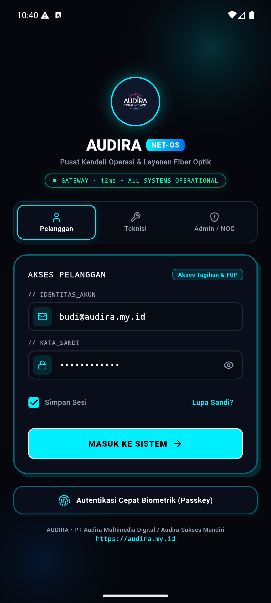
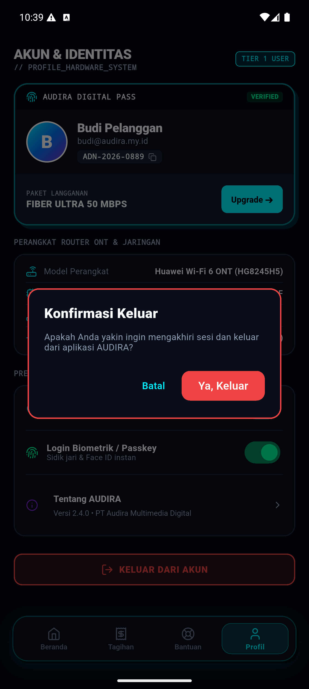
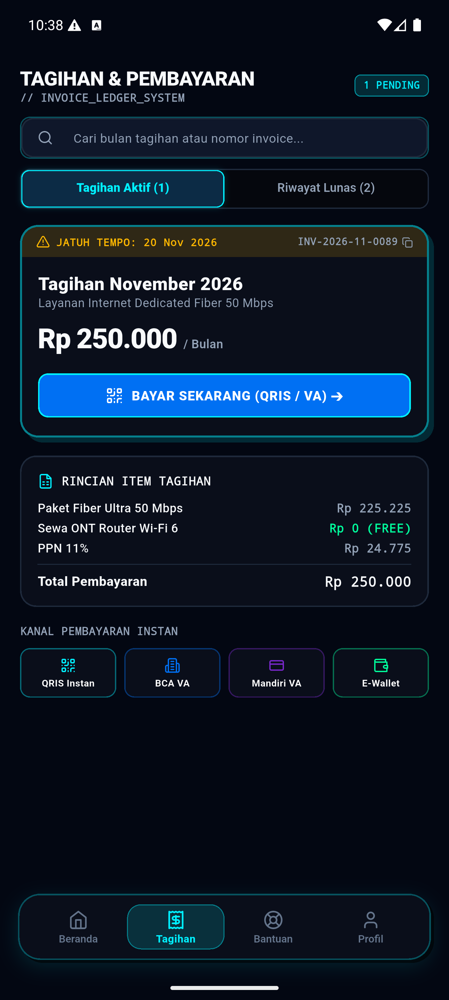
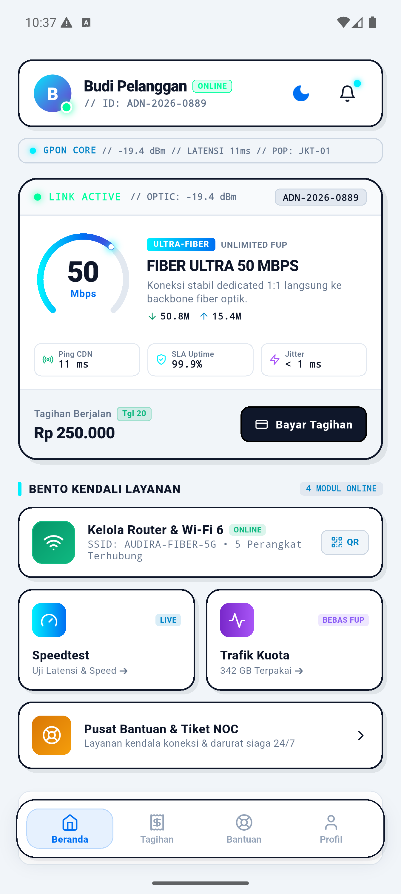
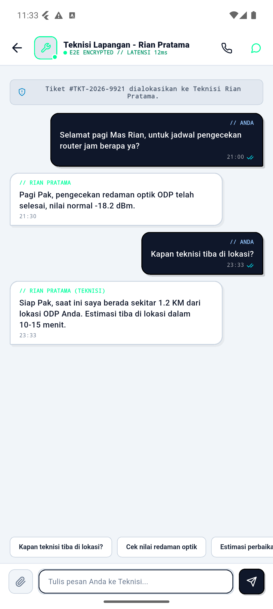
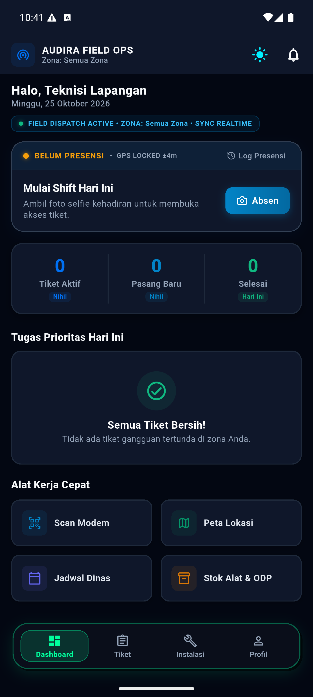
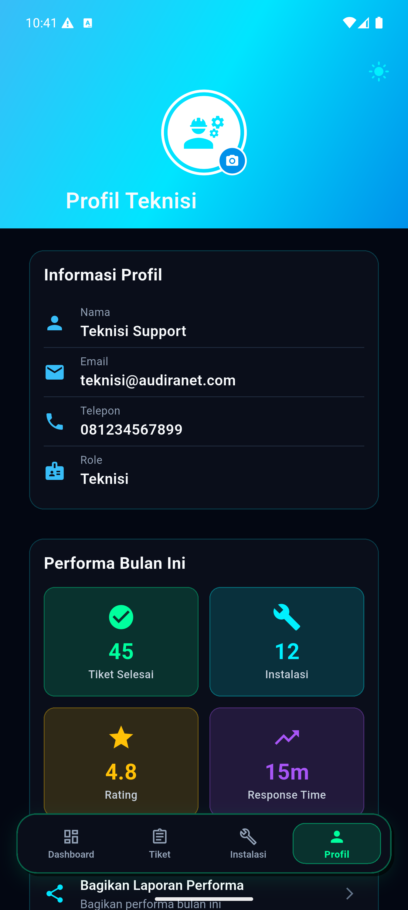

# 🌐 AudiraNet - ISP Management System

**Comprehensive Internet Service Provider Management Application**

[](https://flutter.dev)
[](https://firebase.google.com)
[]()
[]()

---

## 📱 **Platform Support**
- ✅ **Android** (Primary - Flutter)
- ✅ **Web** (Next.js - Production Ready)
- 🚧 **iOS** (Configuration Ready)

---

## 🎯 **Overview**

AudiraNet adalah aplikasi manajemen ISP lengkap yang dirancang untuk mengoptimalkan operasional penyedia layanan internet. Aplikasi ini mendukung 5 role pengguna dengan fitur-fitur canggih untuk customer service, teknisi, admin, supervisor, dan NOC.

### **🌟 Key Highlights**
- 🔐 Multi-role authentication system
- 💳 Integrated payment gateway (Midtrans)
- 📊 Real-time analytics & reporting
- 🎫 Complete ticket management
- 📱 WiFi management & device monitoring
- 🎁 Loyalty & rewards program
- 📅 Work scheduling & calendar
- 📦 Inventory & stock management

---

## 🎨 **UI/UX Showcase — Neo-Brutalism + Cyberpunk Studio**

Aplikasi AUDIRA NET mengadopsi standar desain mutakhir berkarakter **Neo-Brutalism + Cyberpunk Studio**:
- **Midnight OLED Canvas** (`#05070D` & `#0A0E1A`) dengan border cyber kontras tinggi (`1.8px - 2px`).
- **Electric Neon Tokens**: Cyan (`#00F0FF`), Neon Green (`#00FF9D`), Signal Blue (`#0070F3`), dan Purple (`#7928CA`).
- **Bento Box Grid Layout** dengan bayangan taktil tegas (`offset: Offset(4, 4)`, `blurRadius: 0`).
- **Floating Cyber-Capsule Navigation Dock** melayang di seluruh portal pengguna.

### 🔹 Kategori 1: Autentikasi Terpadu & Multi-Role Gateway

| 01. Unified Cyber Login Portal | 06. Neo-Brutalist Logout Modal |
| :---: | :---: |
|  |  |
| **Multi-Role Selector (Pelanggan / Teknisi / Admin)**<br/>Status telemetri gateway online, Passkey auth, dan quick login. | **Konfirmasi Keamanan Berkontras Tinggi**<br/>Pemberian peringatan sesi berakhir dengan pencegahan klik tidak disengaja. |

### 🔹 Kategori 2: Portal Pelanggan & Pengalaman Penagihan (Bento Invoicing)

| 02. Beranda HUD & Arc Gauge | 03. Bento Invoicing & QRIS Rails | 05. Profil Akun & ONT Hardware | 07. Beranda Daytime (Light Mode) |
| :---: | :---: | :---: | :---: |
|  |  |  |  |
| **Cyber Command HUD**<br/>Speedometer Arc, Live RX/TX bandwith, GPON Core telemetry, dan shortcut bento. | **Manajemen Tagihan Transparan**<br/>Rincian biaya itemized, integrasi QRIS Instan, BCA VA, Mandiri VA, dan e-wallet. | **Diagnostik Perangkat Pelanggan**<br/>ID digital verified, spesifikasi ONT Wi-Fi 6, pemantauan redaman optik (-19.4 dBm). | **Mode Terang Neo-Brutalism**<br/>Tampilan kontras tinggi untuk penggunaan di bawah sinar matahari langsung. |

### 🔹 Kategori 3: Pusat Komunikasi Live Chat 24/7 & Notifikasi Cerdas

| 10. Pusat Live Chat Center | 11. Live Chat CS Siaga 24/7 | 12. Live Chat Teknisi Lapangan | 13. Push Notification & Alert Center |
| :---: | :---: | :---: | :---: |
|  |  |  |  |
| **Kotak Masuk Multi-Kanal**<br/>Pemisahan ruang Customer Support vs Teknisi Lapangan, unread badge pill, enkripsi E2E. | **Dialog Interaktif Real-Time**<br/>Balasan pintar otomatis CS Senior, chip aksi instan (*quick replies*), dan nomor hotline darurat. | **Koordinasi Tiket Gangguan ODP**<br/>Pembaruan langsung estimasi kedatangan (ETA) teknisi & nilai redaman optik lapangan. | **Pusat Peringatan Terjadwal**<br/>Pengingat jatuh tempo H-3 otomatis, pesan chat masuk, notifikasi ODP maintenance, dan promo loyalitas. |

### 🔹 Kategori 4: Teknisi Lapangan & Network Operation Center (NOC)

| 04. Customer Bantuan & NOC Telemetry | 08. Floating Capsule Dock Teknisi | 09. Profil Teknisi & Evaluasi KPI |
| :---: | :---: | :---: |
|  |  |  |
| **NOC Health & Hotline 24/7**<br/>Status Core Backbone 100%, latensi core 11ms, SLA 99.98%, akses AI *"Tanya Audi"*, dan tombol cepat chat teknisi tiket. | **Operasional Lapangan Digital**<br/>Floating Capsule Dock (Tugas, Absen, Peta, Profil), GPS selfie check-in, dan daftar penugasan SPK live. | **Evaluasi Kinerja & Inventori**<br/>Metrik KPI real-time (Tiket Selesai, Instalasi Baru, Rating Pelanggan, Speed Response), scanner barcode ONT. |

👉 *Dokumentasi visual lengkap 13 tangkapan layar resolusi penuh dapat dilihat di [docs/screenshots/README.md](docs/screenshots/README.md).*

---

## 📂 **Project Structure**

```
AUDIRANET/
├── 📱 android/          # Android configuration
├── 💻 lib/              # Flutter app source code
│   ├── config/         # Routes & theme
│   ├── models/         # Data models (20+)
│   ├── screens/        # UI screens (50+)
│   ├── services/       # Business logic (15+)
│   ├── utils/          # Utilities
│   └── widgets/        # Reusable components (30+)
├── 🌐 audiranet-web/   # Next.js web application (NEW!)
│   ├── app/            # Next.js pages (10 pages)
│   ├── components/     # React components
│   ├── lib/            # Firebase integration
│   └── *.bat           # Windows batch scripts
├── 📚 docs/            # Documentation (21 files)
├── 🔧 scripts/         # Automation scripts (6 files)
├── 🎨 assets/          # Images & resources
└── 🧪 test/            # Testing files
```

📖 **Detailed structure:**
- [docs/PROJECT_STRUCTURE.md](docs/PROJECT_STRUCTURE.md) - Folder organization
- [docs/VISUAL_TREE.md](docs/VISUAL_TREE.md) - Complete visual tree
- [docs/QUICK_REFERENCE.md](docs/QUICK_REFERENCE.md) - Quick access guide

---

## 🚀 **Quick Start**

### **Prerequisites**
- Flutter SDK 3.32.8 or higher
- Firebase CLI installed
- Android Studio / VS Code

### **Installation**

1. **Clone & Setup**
```bash
git clone <repository-url>
cd AUDIRANET
flutter pub get
```

2. **Firebase Configuration**
```bash
# Deploy indexes
firebase deploy --only firestore:indexes

# Verify deployment
firebase firestore:indexes
```

3. **Run Mobile App (Flutter)**
```bash
# Run on connected device/emulator
flutter run

# Build release APK
flutter build apk --release
```

4. **Run Web App (Next.js)** 🌐 NEW!
```bash
# Option 1: Using batch file (Windows)
cd audiranet-web
start-web.bat

# Option 2: Using npm
cd audiranet-web
npm install
npm run dev
```

Web app opens at: **http://localhost:3000**

📖 **Web Documentation:**
- [audiranet-web/README.md](audiranet-web/README.md) - Quick start
- [audiranet-web/BATCH_FILES_GUIDE.md](audiranet-web/BATCH_FILES_GUIDE.md) - Batch scripts guide
- [docs/NEXTJS_WEB_INTEGRATION.md](docs/NEXTJS_WEB_INTEGRATION.md) - Complete integration guide

---

## 👥 **Test Accounts**

| Role | Email | Password | Access Level |
|---|---|---|---|
| 👤 **Customer** | customer1@gmail.com | customer123 | Bills, tickets, WiFi |
| 🔧 **Teknisi** | andi.teknisi@audiranet.id | teknisi123 | Work orders, inventory |
| 👨‍💼 **Admin** | admin@audiranet.id | admin123 | Full management |
| 📊 **Supervisor** | hendra.spv@audiranet.id | supervisor123 | Analytics, oversight |
| 🖥️ **NOC** | noc@audiranet.id | noc123 | Network monitoring |

---

## ✨ **Features by Role**

### **👤 Customer Features**
- ✅ Dashboard with package info & usage
- ✅ Bill management & payment
- ✅ Ticket creation & tracking
- ✅ Speed test
- ✅ **WiFi Management** ⭐ NEW
  - Change SSID & Password
  - Guest Network setup
  - Connected devices monitor
  - Device blocking
- ✅ Loyalty & Rewards
- ✅ Package upgrade/downgrade
- ✅ Payment history
- ✅ Usage analytics

### **🔧 Teknisi Features**
- ✅ Work order dashboard
- ✅ Ticket assignment & resolution
- ✅ Real-time status updates
- ✅ Inventory management
- ✅ Stock requests
- ✅ Work schedule calendar
- ✅ Performance KPI tracking
- ✅ Route optimization

### **👨‍💼 Admin Features**
- ✅ Customer management
- ✅ Teknisi management
- ✅ Broadcast notifications
- ✅ Package configuration
- ✅ Reporting & analytics
- ✅ Payment verification
- ✅ Upgrade request approval
- ✅ System settings

### **📊 Supervisor Features**
- ✅ Team monitoring
- ✅ Performance analytics
- ✅ SLA tracking
- ✅ Revenue reports
- ✅ Customer satisfaction metrics
- ✅ Resource allocation

### **🖥️ NOC Features**
- ✅ Network monitoring
- ✅ Real-time alerts
- ✅ Performance metrics
- ✅ Incident management
- ✅ System health dashboard

---

## 🔥 **Firebase Integration**

### **Services Used**
- 🔐 **Authentication** - Email/Password
- 💾 **Firestore** - Real-time database (10 indexes)
- 📁 **Storage** - File uploads
- 📊 **Analytics** - User tracking

### **Firestore Indexes**
```bash
# View deployed indexes
firebase firestore:indexes

# Deploy new indexes
firebase deploy --only firestore:indexes
```

**Current Indexes:** 10 total
- Customer queries (payments, points, devices)
- Teknisi operations (schedules, inventory, requests)
- Admin management (upgrades, analytics)

---

## 📦 **Dependencies**

### **Core**
- `firebase_core`, `firebase_auth`, `cloud_firestore`, `firebase_storage`
- `provider` (State management)

### **UI/UX**
- `intl` (Internationalization)
- `pdf`, `printing` (PDF generation)

### **Utilities**
- `http`, `connectivity_plus`
- `shared_preferences`, `sqflite`
- `url_launcher`, `image_picker`
- `mobile_scanner`, `package_info_plus`

📋 **Full list:** [pubspec.yaml](pubspec.yaml)

---

## 📚 **Documentation**

### **Getting Started**
- 📖 [Usage Guide](docs/USAGE_GUIDE.md) - Complete feature walkthrough
- 🔥 [Firebase Setup](docs/FIREBASE_SETUP_GUIDE.md) - Firebase configuration
- 🔧 [Project Structure](docs/PROJECT_STRUCTURE.md) - Folder organization

### **Implementation**
- 📝 [Phase 1](docs/IMPLEMENTATION_PHASE1.md) - Core features
- 📝 [Phase 2](docs/IMPLEMENTATION_PHASE2.md) - Enhanced operations
- 📝 [Phase 3](docs/IMPLEMENTATION_PHASE3.md) - Premium features

### **Analysis & Reports**
- 📊 [Comprehensive Audit](docs/COMPREHENSIVE_AUDIT_REPORT.md)
- 🎯 [Quick Wins](docs/QUICK_WINS_GUIDE.md)
- 👥 [Role Features Matrix](docs/ROLE_FEATURES_AUDIT.md)

---

## 🛠️ **Scripts**

### **Firebase Deployment**
```powershell
# Windows
.\scripts\deploy_firebase_indexes.ps1

# Linux/Mac
./scripts/deploy_indexes.sh
```

### **User Management**
```bash
# Show all users (Dart)
flutter run scripts/show_users.dart

# Show all users (Python)
python scripts/show_users.py
```

### **Setup Phase 3**
```powershell
.\scripts\setup_firebase_phase3.ps1
```

---

## 🎨 **Screenshots**

### **Customer Dashboard**
- Modern UI with gradient cards
- Real-time package usage
- Quick action buttons
- Interactive promo banners

### **WiFi Management** ⭐ NEW
- 4-tab interface (Overview, Devices, Guest, Parental)
- Real-time device monitoring
- Guest network configuration
- Parental control framework

### **Admin Panel**
- Comprehensive analytics
- Customer management
- Broadcast notifications
- Revenue tracking

---

## 🚀 **Roadmap & Development Status**

### **Phase 4: Next-Gen Features** ✅ *(100% Completed)*
- ✅ **Live Chat System (Real-Time E2E)**
  - Dual channel support: Customer ↔ CS Siaga 24/7 & Customer ↔ Teknisi Lapangan.
  - Multi-stream inbox (`LiveChatListPage`) dengan filter tab, pencarian, dan unread counters.
  - Chat room interaktif (`LiveChatRoomPage`) dengan Quick Action Chips, pesan terenkripsi E2E, centang status (`✓✓`), dan fallback WhatsApp & Call Hotline.
  - Dual sync engine: Stream broadcast real-time fallback + sinkronisasi persistent Firebase Firestore & Realtime WebSocket.
  - Automated intelligent reply engine (simulasi respon cepat CS Senior & Teknisi Lapangan dalam 2 detik).
- ✅ **Automated Push Notifications & Alert Center**
  - Scheduled billing reminder otomatis (deteksi jatuh tempo 3 hari sebelum batas).
  - Incoming live chat notifications dengan sound, vibration, dan navigasi langsung ke room.
  - Status pemeliharaan jaringan kabel fiber optik ODP.
  - Penawaran voucher promo loyalitas dan diskon upgrade paket.
- ✅ **Network Monitoring Dashboard (Customer & NOC)**
  - Dynamic Speedometer Arc Gauge dengan pengujian real-time Ping CDN, Jitter, SLA Uptime, dan kecepatan unduh/unggah.
  - Pelacakan kuota & pemakaian bandwidth (`BandwidthUsagePage` & `UsageAnalyticsPage`).
  - NOC Centralized Dashboard (`noc_dashboard_page.dart`) dengan pemantauan OLT/Mikrotik, modem ONT, dan health score.

### **Future Enhancements (Phase 5)**
- 🔮 Voice AI incident diagnostics assistant
- 🔮 Predictive optical attenuation drift forecasting
- 🔮 Advanced GIS technician routing with turn-by-turn navigation
- 🔮 Multi-language & regional Indonesian dialect localization

---

## ⚖️ Lisensi Komersial / Proprietary (Berbayar)

Perangkat lunak ini didistribusikan di bawah **Lisensi Komersial Proprietary AUDIRA**.
- Hak cipta penuh dilindungi undang-undang.
- Dilarang keras menggandakan, mendistribusikan ulang, menjual kembali, atau merekayasa balik (reverse engineer) kode sumber ini tanpa izin tertulis atau lisensi berbayar resmi dari pemilik hak cipta.
- Detail lengkap dapat dilihat pada berkas [`LICENSE`](./LICENSE).

---

## 👥 Developer & Official Contact

### Founder & Organization
- **Author & Founder**: Agus Dwi Rianto (AUDIRA)
- **Organization**: Audira Multimedia Digital / Audira Sukses Mandiri
- **Official Production Domain**: [https://audira.my.id](https://audira.my.id)

### 📧 Official Contact
- **Official Email**: [agusdwirianto@gmail.com](mailto:agusdwirianto@gmail.com)
- **Business Partnership**: Contact the official email above.
- **General Support**: Contact the official email above.
- **Security & Vulnerability Reports**: Contact the official email above.
- **WhatsApp Hotline**: [+62 821-1200-1600](https://wa.me/6282112001600)
- **Telegram Community**: *To be announced*
- **Discord Server**: *To be announced*

---

## 🔐 Security & Responsible Disclosure
For business inquiries, technical support, partnership opportunities, and security vulnerability reports, please use the official email address listed above:
- **Email**: [agusdwirianto@gmail.com](mailto:agusdwirianto@gmail.com)
- Untuk laporan kerentanan (vulnerability reports), sertakan deskripsi yang jelas, dampak, serta langkah-langkah reproduksi. Jangan menyertakan kredensial sensitif atau kata sandi.

---

## © Project Ownership & Attribution
**AUDIRA** is an ecosystem of digital products, AI-powered applications, automation systems, and technology solutions developed under the **AUDIRA** brand.  
All product names, source code, designs, and associated intellectual property are subject to their respective ownership rights and applicable licenses.

- **Official Brand**: AUDIRA
- **Founder**: Agus Dwi Rianto
- **Organization**: Audira Multimedia Digital / Audira Sukses Mandiri
- **Website**: [https://audira.my.id](https://audira.my.id)
- **Official Email**: [agusdwirianto@gmail.com](mailto:agusdwirianto@gmail.com)

